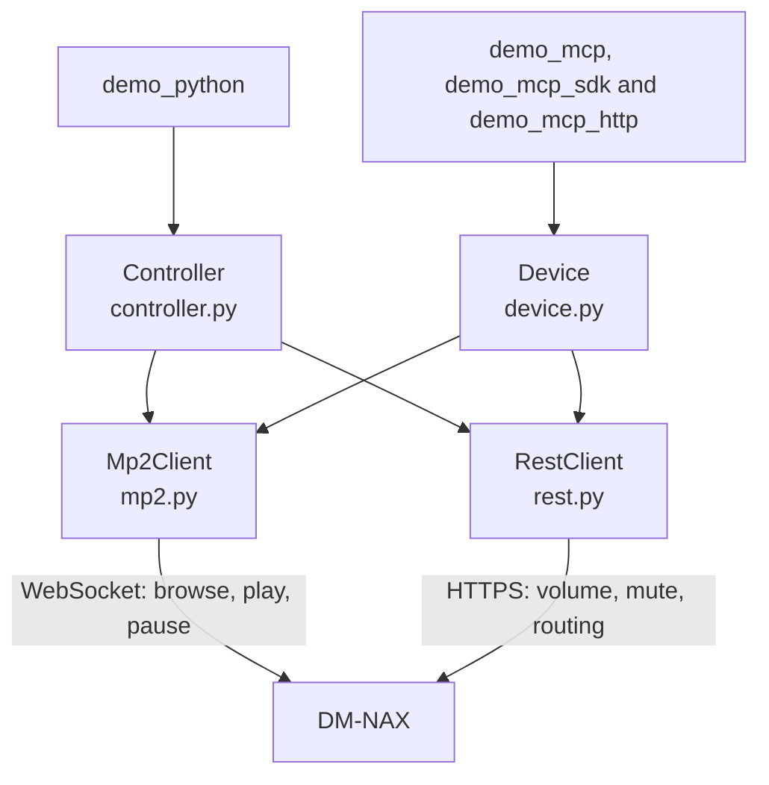

# crestron: the library

The code that talks to the device. The four demo folders use it; it has no program of its own to run.

- Needs `websockets` (in `requirements.txt`). The code itself still runs on Python 3.8+, but the workshop needs 3.10+.
- Used by `demo_python/`, `demo_mcp/`, `demo_mcp_http/`, `demo_mcp_sdk/`, and the tests in `tests/`.

## How the code flows



Every change has two steps: send it, then wait until the device shows it happened.

**Play or pause (`mp2.py`).** Send the command, then wait for a push from the device that arrived after it (`_transport` in `controller.py`):

```python
baseline = await self.mp2.action(self.config.player, action)
await self.mp2.wait_player(self.config.player, baseline, expected)
```

**Volume (`rest.py`).** Write it, then read it back (`set_audio`):

```python
reply = self._request("/Device", change)
# ...
actual = at_path(self._request(path), path) or {}
if actual.get("ZoneAudio", {}).get(property_name) != value:
    raise DemoError(
        "REST read-back did not match {}={}.".format(property_name, value)
    )
```

**Login.** MP2 signs its WebSocket connection request with the client secret (`auth_header`). REST logs in with the admin user and password and gets back a cookie and an XSRF token (`_login`).

**Which function sends which API call:**

| Function | API call |
| --- | --- |
| `Mp2Client.open` | WebSocket connect, then `RegisterClient` |
| `Mp2Client.get` | `GetCresNextObject` |
| `Mp2Client.subscribe` | `SubscribeToObject` |
| `Mp2Client.browse`, `navigate` | `MediaNavigation` (browse, search, home screen) |
| `Mp2Client.favorites` | `MediaFavorites` `ListFavorites` |
| `Mp2Client.load_source`, `action` | `MediaPlayerNeXt` `LoadSource`, `Play`, `Pause`, ... |
| `RestClient.get` | `GET /Device/...` (logs in first if needed) |
| `RestClient.set_audio`, `set_route` | `POST /Device`, then a `GET` to read back |
| `RestClient.close` | `GET /logout` |

Real requests and replies: [demo_python/README.md](../demo_python/README.md#api-calls-to-the-device).

## Files

| File | What it does |
| --- | --- |
| `config.py` | Loads and checks `config/config.json`, the file every program reads by default. |
| `mp2.py` | Media Player 2.0 WebSocket client: signed login, subscriptions, browse, play, pause. |
| `rest.py` | DM-NAX REST client: login, XSRF token, zone reads, and writes that are read back. |
| `state.py` | Player state built from MP2 pushes, and small helpers for device JSON. |
| `device.py` | What each MCP tool reads, previews and changes. |
| `controller.py`, `workflow.py` | The direct demo: finding the player, zone and station, then the fixed script. |
| `console.py` | Terminal output for the direct demo. |
| `errors.py` | `DemoError`: errors the programs print as a short message instead of a traceback. |
