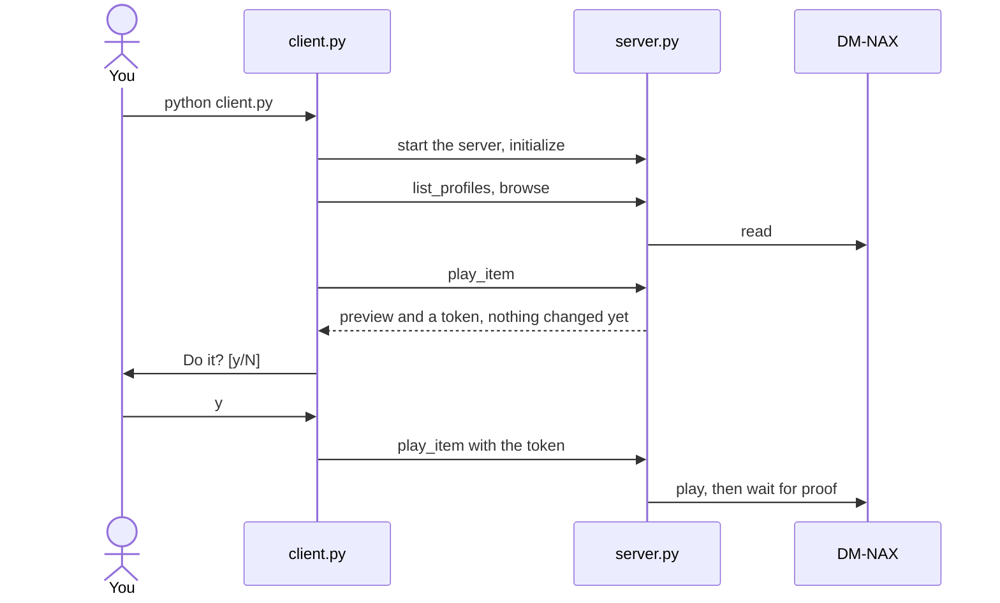

# demo_mcp: hand-written MCP server and menu

An MCP server that offers the device as 15 tools, plus a menu program that uses them. Every change is previewed and only happens after you approve it.

Reads `config/config.json`, or `--config <file>`. Setup: [Getting started](../docs/GETTING-STARTED.md).

## Run

`python demo_mcp/client.py` starts `server.py` and shows the menu; `python demo_mcp/server.py` is the server on its own, for an AI host. The keys to type and what to check: [Getting started, section 5](../docs/GETTING-STARTED.md#5-mcp-over-stdio-demo_mcp-demo_mcp_sdk).

## How the code flows



- `client.py` starts `server.py` and sends it JSON messages, one per line, over stdin and stdout. An AI host such as Claude Code can take the menu's place.
- A change takes two calls. The first returns a preview and a token. The second, with the token, makes the change. From `Menu.approve` in `client.py`:

  ```python
  first = await self.call(tool, **args)
  preview = first["preview"]
  print("Preview: " + preview["change"])
  # ...
  if ask("Do it? [y/N]: ").lower() != "y":
  # ...
  result = await self.call(tool, confirm=True, token=first["token"], **args)
  ```

- A token works once, within 120 seconds. If the device changed since the preview, the server refuses.
- On quit, the server only pauses what it started.

## API calls per tool

Each tool sends these device calls. Full example messages are in [demo_python/README.md](../demo_python/README.md#api-calls-to-the-device).

| Tool | API | Device call |
| --- | --- | --- |
| `list_profiles`, `list_services` | MP2 | `GetCresNextObject` `/Device/StreamingServices/UserProfiles` |
| `browse` | MP2 | `MediaNavigation` `ProviderBrowseMenu` |
| `search` | MP2 | `MediaNavigation` `SearchMenu` |
| `home_screen` | MP2 | `MediaNavigation` `HomeScreenMenu` |
| `list_favorites` | MP2 | `MediaFavorites` `ListFavorites` |
| `list_players` | MP2 + REST | `GetCresNextObject` `/Device/MediaPlayerNeXt/Players`, plus REST reads to show which zones hear each player |
| `list_zones` | REST | `GET` `/Device/ZoneOutputs`, `/Device/AvMatrixRouting`, `/Device/InputSources` |
| `list_inputs` | REST | `GET` `/Device/InputSources` |
| `play_item` | MP2 | `LoadSource`, then wait for a `playing` push |
| `player_action` | MP2 | `Play`, `NextTrack`, `PreviousTrack`, `Seek`, `Ffwd`, `Rewind`, `Shuffle` or `Repeat`, then wait for a push that shows it |
| `pause` | MP2 | `Pause`, then wait for a `paused` push |
| `set_volume` | REST | `POST /Device` `ZoneAudio.Volume` (percent x 10), then read back |
| `set_mute` | REST | `POST /Device` `ZoneAudio.IsMuted`, then read back |
| `set_route` | REST | `POST /Device` `AvMatrixRouting.Routes.<zone>.AudioSource`, then read back |

The preview (the first call of a change) only reads. Here are two requests the direct demo never sends.

**Search** (MP2):

```json
{"Device": {"MediaNavigation": {"RequestAction": {
  "RcSessionId": "RC57042fcbb3154da0", "ProfileKey": "Profile1", "MenuCategory": "SearchMenu",
  "MenuCategoryOptions": {"SearchProviderKey": "Provider1", "SearchText": "jazz",
                          "SearchCategory": "station", "ItemCount": 20, "ItemOffset": 0}}}}}
```

The reply is a menu, like a browse reply.

**Route an input to a zone** (REST, `POST /Device` with the XSRF token):

```json
{"Device": {"AvMatrixRouting": {"Routes": {"Zone1": {"AudioSource": "Input03"}}}}}
```

```json
{"Actions": [{"Operation": "SetPartial", "TargetObject": "Device",
  "Results": [{"Path": "Device.AvMatrixRouting.Routes.Zone1.AudioSource",
               "Property": "AudioSource", "StatusId": 0, "StatusInfo": "OK"}]}]}
```

Then `GET /Device/AvMatrixRouting` must show `Zone1` on `Input03`.

## Files

| File | What it does |
| --- | --- |
| `protocol.py` | The 15 tools, their arguments and the approval rules. `demo_mcp_sdk/` and `demo_mcp_http/` use it too. |
| `server.py` | The MCP server: JSON-RPC over stdin and stdout, one message per line. |
| `client.py` | The menu program. `demo_mcp_sdk/client.py` and `demo_mcp_http/client.py` reuse it. |
