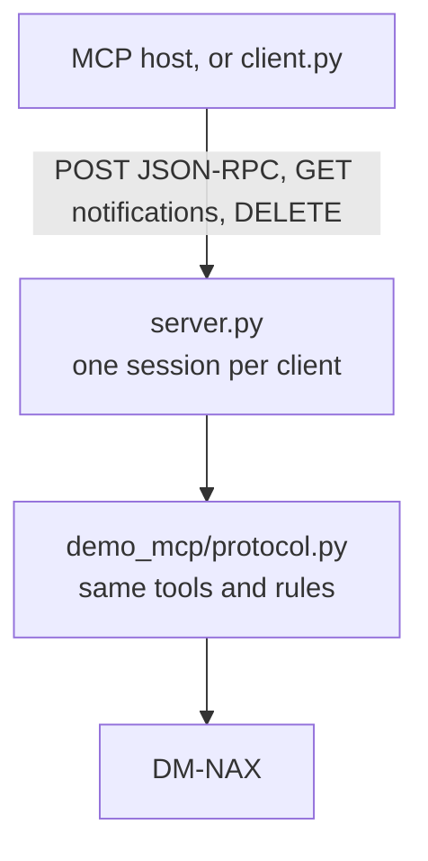

# demo_mcp_http: the same tools over HTTP

The 15 tools from `demo_mcp/`, served over MCP Streamable HTTP instead of stdin/stdout, plus the same menu. You start the server yourself; the menu (or an AI host) connects to its URL.

The server reads `config/config.json`, or `--config <file>`; the client only needs the server's URL (`--url`). Setup: [Getting started](../docs/GETTING-STARTED.md).

## Run

Start `python demo_mcp_http/server.py` (serves `http://127.0.0.1:8000/mcp`; options `--port`, `--config <file>`, `--session-timeout` (900 s), `--max-sessions` (16)), then `python demo_mcp_http/client.py` (`--url`) in a second terminal. The commands and what to check: [Getting started, section 6](../docs/GETTING-STARTED.md#6-mcp-over-http-demo_mcp_http).

To use it from an AI host, pick one that supports Streamable HTTP and give it the URL. The host doesn't start the server, so start it yourself first. Keep the host's per-tool approval prompts on.

## How the code flows

The tools and rules are the same as in [demo_mcp](../demo_mcp/README.md#how-the-code-flows); only the transport is different.

- **Protocol.** MCP 2025-11-25, with sessions. `initialize` returns an `Mcp-Session-Id` header, and later requests send it back along with `MCP-Protocol-Version: 2025-11-25`. POST carries JSON-RPC, GET opens an event stream (SSE) for `notifications/tools/list_changed`, and DELETE ends the session. The newer stateless protocol isn't supported. The official Python SDK client can still connect with `Client(url, mode="legacy")`.
- **Sessions.** Each session has its own approval tokens, item ids and device connections. Ids don't carry over, so after reconnecting, browse again. A session expires after `--session-timeout` seconds without activity. A dropped request or event stream doesn't end it.
- **Approval.** As in demo_mcp, a change takes two calls. A token works once, within 120 s, for exactly the previewed arguments, and only if the device still matches the preview. There's no elicitation.
- **One device, many sessions.** The server opens at most one new device connection or login every 10 seconds, across all sessions. A second session may be told how long to wait before trying again. One server process keeps track of which session pauses what on exit.
- **Local only.** The server only listens on a loopback address (`--host` must be one) and checks the Host and Origin headers. The config's `verify_tls` setting applies to the device connection, not to this endpoint.

Device calls are the same as in demo_mcp: [API calls per tool](../demo_mcp/README.md#api-calls-per-tool).

## Files

| File | What it does |
| --- | --- |
| `server.py` | The HTTP endpoint at `/mcp`: Host and Origin checks, POST, GET (event stream) and DELETE. |
| `runtime.py` | Sessions: each one's device connections and tokens, idle expiry, limits, connection pacing, and pausing on exit. |
| `client.py` | Runs the `demo_mcp/client.py` menu over HTTP. |
