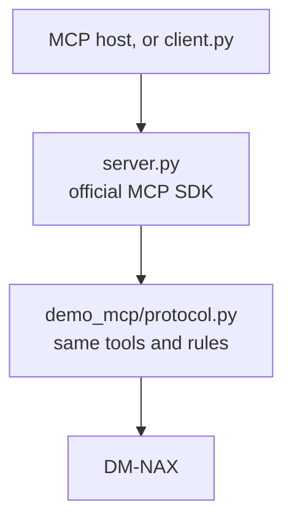

# demo_mcp_sdk: the same tools on the official MCP SDK

The 15 tools from `demo_mcp/`, served with the official MCP Python SDK, plus a launcher for the same menu. This is the best server to give an AI host, and the only one that can ask for approval through MCP elicitation.

The tools and approval rules live only in `demo_mcp/protocol.py`, so all the servers behave the same. Reads `config/config.json`, or `--config <file>`. Setup: [Getting started](../docs/GETTING-STARTED.md).

## Run

`python demo_mcp_sdk/client.py` starts `server.py` and shows the menu; `python demo_mcp_sdk/server.py` is the server on its own, for an AI host. The keys to type, Claude Code registration and what to check: [Getting started, section 5](../docs/GETTING-STARTED.md#5-mcp-over-stdio-demo_mcp-demo_mcp_sdk).

## How the code flows



The tools and rules are the same as in [demo_mcp](../demo_mcp/README.md#how-the-code-flows); only the wrapper is different. The one real difference is approval. If the host supports it, the server asks the user with a yes/no form (MCP elicitation) instead of handing out a token. From `call` in `server.py`:

```python
async def approve(message: str) -> bool:
    reply = await ctx.elicit(message, Approval)  # no lock held while they decide
    return isinstance(reply, AcceptedElicitation) and reply.data.confirm
```

Device calls are the same as in demo_mcp: [API calls per tool](../demo_mcp/README.md#api-calls-per-tool).

## Files

| File | What it does |
| --- | --- |
| `server.py` | The SDK server. It offers the tools from `demo_mcp/protocol.py`. |
| `client.py` | Starts the `demo_mcp/client.py` menu against this server. |
| `__init__.py` | `available()`: checks whether this Python can run the SDK. |
