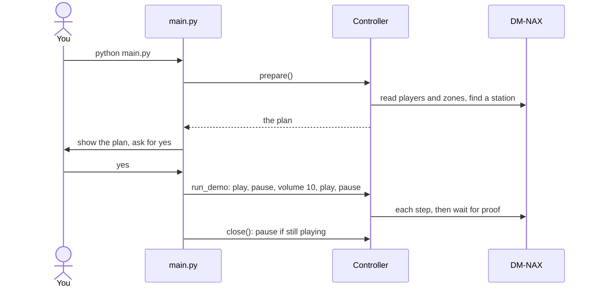
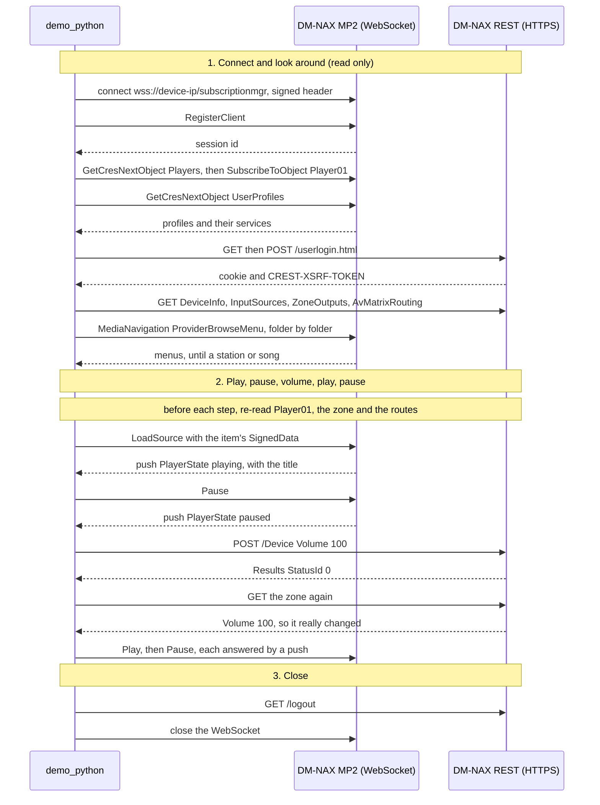

# demo_python: the direct demo

A fixed script: play the first Internet Radio station (or song) for 30 s, pause, set the player's zone to 10%, read the volume back, play 5 s more, pause. The class server's `client-config.json` shortens this to 5 s and 3 s (`initial_seconds`, `resume_seconds`).

Reads `config/config.json`, or `--config <file>`. Setup: [Getting started](../docs/GETTING-STARTED.md).

## Run

Commands, expected output and what to check on the demo server: [Getting started, section 3](../docs/GETTING-STARTED.md#3-direct-demo-demo_python). Options: `--check` (only reads and prints the plan), `--execute` (runs without asking), `--config <file>`. On an error or Ctrl-C it pauses the player before exiting (exit code 1, or 130 for Ctrl-C).

## How the code flows



1. **`prepare()` only reads.** It stops if the player is busy or if it can't tell which zone to use. `--check` ends here.
2. **`run_demo()` is the whole script** (in `crestron/workflow.py`):

   ```python
   status = await controller.load_track()
   # ...
   verified(await controller.pause(), state="paused")
   # ...
   verified(await controller.set_volume(10), state="paused", volume=10)
   # ...
   verified(await controller.play(), state="playing", volume=10)
   ```

3. **On an error or Ctrl-C,** it pauses the player, closes both connections and prints a one-line message. The exit code is 1, or 130 for Ctrl-C.

How each step is checked: [crestron/README.md](../crestron/README.md#how-the-code-flows).

## API calls to the device

The device has two APIs: **MP2** (Media Player 2.0) over a WebSocket for the player, and **REST** over HTTPS for zones and volume. These are the main calls in one demo run, in order:



Below are real requests and replies from one run against the class server, shortened (`...`). `MsgId` (a fresh id on every MP2 request) is left out.

### MP2: every message has the same wrapper

```json
{"Device": {"<Command>": {"RequestAction": { ... }}}}
```

Commands used: `SubscriptionMgr` (register, read, subscribe), `MediaNavigation` (browse), `MediaPlayerNeXt` (play, pause). Replies and pushes come back as `{"Device": {...}}` holding just the part that changed.

### 1. Register: get a session id

```json
{"Device": {"SubscriptionMgr": {"RequestAction": {
  "RegistrationAction": "RegisterClient",
  "RegistrationActionOptions": {"RegisteringClientIds": ["python-demo-98bdc746-..."]}}}}}
```

```json
{"Device": {"SubscriptionMgr": {"ConnectedClientWsCount": 1,
  "WsConnectionsList": {"WsConnection3": {"RegisteredClientList": {
    "RC57042fcbb3154da0": {"RegisteredClientId": "python-demo-98bdc746-..."}}}}}}}
```

`RC57042fcbb3154da0` is the session id (`RcSessionId`); every later request carries it.

### 2. Read something once: GetCresNextObject

```json
{"Device": {"SubscriptionMgr": {"RequestAction": {
  "RegistrationAction": "GetCresNextObject",
  "RegistrationActionOptions": {"RcSessionId": "RC57042fcbb3154da0",
                                "CresNextObject": "/Device/MediaPlayerNeXt/Players"}}}}}
```

```json
{"Device": {"MediaPlayerNeXt": {"Players": {
  "Player01": {"PlayerState": "stopped", "AvailableActions": [],
    "Player": {"ProfileKey": "", "ProviderKey": "", "SignedData": {},
      "NowPlayingData": {"TrackTitle": "", "StationName": "", ...}}},
  "Player02": {"PlayerState": "stopped", ...}, ...}}}}
```

`paused` or `stopped` means idle and usable. On a real device `ready` means an inactive player slot the demo cannot use. The same call on `/Device/StreamingServices/UserProfiles` returns the profiles and services:

```json
{"Device": {"StreamingServices": {"UserProfiles": {
  "Profile1": {"Name": "Main House", "AssignedProviders": {
    "Provider1": {"Name": "Internet Radio", "IsAuthenticated": true},
    "Provider2": {"Name": "DemoStream", "IsAuthenticated": true}}},
  "Profile2": {"Name": "Guest", ...}}}}}
```

### 3. Subscribe: ask for pushes from now on

```json
{"Device": {"SubscriptionMgr": {"RequestAction": {
  "RegistrationAction": "SubscribeToObject",
  "RegistrationActionOptions": {"RcSessionId": "RC57042fcbb3154da0", "CresNextPath": [
    "/Device/MediaNavigation/RegisteredClientMenus/RC57042fcbb3154da0",
    "/Device/MediaPlayerNeXt/Players/Player01"]}}}}}
```

The reply lists the paths under `SubscribedTo`. From now on every change to Player01 arrives as a push without asking.

### 4. Browse: one folder at a time

The first call (`BrowseKey` = the service, here `Provider1`) lists the top folders: Popular stations, Jazz & Blues, News & Talk. Opening a folder sends back its `BrowseKey` and `SignedData` exactly as received:

```json
{"Device": {"MediaNavigation": {"RequestAction": {
  "RcSessionId": "RC57042fcbb3154da0", "ProfileKey": "Profile1",
  "MenuCategory": "ProviderBrowseMenu",
  "MenuCategoryOptions": {"ProviderKey": "Provider1", "BrowseKey": "ir:popular",
                          "ItemCount": 20, "ItemOffset": 0,
                          "SignedData": {"SourceData": {"Node": "ir:popular", ...},
                                         "Signature": "KjYziMhgvrtDGNt+p4kt5Y3b..."}}}}}}
```

```json
{"Device": {"MediaNavigation": {"RegisteredClientMenus": {"RC57042fcbb3154da0": {
  "LastRequestAction": {"MsgId": "b44fdd51-...", "MenuCategory": "ProviderBrowseMenu"},
  "MenuUpdates": {"ProviderBrowseMenu": {"Categories": {"Category1": {
    "DisplayMenuName": "Popular stations", "ItemCount": 20, "TotalItemCount": 24,
    "MenuDataItems": [
      {"BrowseKey": "ir:pop:01", "BrowseItemName": "Harbor FM",
       "StreamingMediaType": "station",
       "SignedData": {"SourceData": {"Node": "ir:pop:01", ...},
                      "Signature": "XnkCImJLGuehetdlShVr8RH6..."}}, ...]}}}}}}}}
```

The reply echoes the request's `MsgId` (left out of the requests above), which is how the client matches it. The device signs `SignedData`, so it must not be changed.

### 5. Play: LoadSource, then wait for the push

```json
{"Device": {"MediaPlayerNeXt": {"RequestAction": {
  "RcSessionId": "RC57042fcbb3154da0", "PlayerId": "Player01", "ActionId": "LoadSource",
  "ActionIdOptions": {"ProfileKey": "Profile1", "ProviderKey": "Provider1",
                      "AudioSourceUrl": "", "AutoPlay": true,
                      "SignedData": {"SourceData": {"Node": "ir:pop:01", ...},
                                     "Signature": "XnkCImJLGuehetdlShVr8RH6..."}}}}}}
```

The demo doesn't wait for a reply to the command itself. Instead, it watches the pushes that follow:

```json
{"Device": {"MediaPlayerNeXt": {"Players": {"Player01": {"PlayerState": "playing",
  "AvailableActions": ["Pause", "Stop"],
  "Player": {"ProfileKey": "Profile1", "ProviderKey": "Provider1", ...,
    "NowPlayingData": {"TrackTitle": "Burning Signal / Silas Grey Trio",
                       "StationName": "Harbor FM", "StreamingMediaType": "station",
                       "Duration": 0, "ElapsedSec": 0, ...}}}}}}}
```

The demo only counts it as playing when a push that arrives after its command shows `playing` with the station it asked for. On a live station `TrackTitle` is the current programme and `StationName` the station, so either field may carry the name.

### 6. Pause and Play: same message, other ActionId

```json
{"Device": {"MediaPlayerNeXt": {"RequestAction": {
  "RcSessionId": "RC57042fcbb3154da0", "PlayerId": "Player01",
  "ActionId": "Pause", "ActionIdOptions": {}}}}}
```

```json
{"Device": {"MediaPlayerNeXt": {"Players": {"Player01": {
  "PlayerState": "paused", "AvailableActions": ["Play", "Stop"], ...}}}}}
```

### 7. REST login: cookie, then XSRF token

```text
GET  https://device-ip/userlogin.html     -> 200, Set-Cookie: TRACKID=...
POST https://device-ip/userlogin.html     body: login=<admin_user>&passwd=<admin_password>
                                          -> reply header CREST-XSRF-TOKEN: 6f1c...
                                             Set-Cookie: AuthByPasswd=..., userid=...
```

A real DM-NAX also sets `iv`, `tag` and `userstr`, so keep every cookie the device
sends. Every later request sends the cookies; every write also sends
`X-CREST-XSRF-TOKEN`. A wrong login answers 403.

### 8. REST read

```text
GET https://device-ip/Device/ZoneOutputs
```

```json
{"Device": {"ZoneOutputs": {"Version": "2.1.0", "Zones": {"Zone1": {"Name": "Kitchen",
  "IsBussed": false, "IsSignalDetected": false,
  "ZoneAudio": {"Volume": 250, "VolumedB": -60.0, "IsMuted": false,
                "MinVolume": 0, "MaxVolume": 1000},
  "ZoneBasedProviders": {"ReservedPlayer": "Input05"}}, ...}}}}
```

Volume is in tenths of a percent: 250 = 25%. Player01 is the first `MediaPlayer` input, `Input05`. `ReservedPlayer` says which media-player input belongs to this zone; that is how the demo finds the zone for Player01. The other reads (`DeviceInfo`, `InputSources`, `AvMatrixRouting`) look the same.

### 9. REST write, then read back

```text
POST https://device-ip/Device
Content-Type: application/json
X-CREST-XSRF-TOKEN: 6f1c...
```

```json
{"Device": {"ZoneOutputs": {"Zones": {"Zone1": {"ZoneAudio": {"Volume": 100}}}}}}
```

```json
{"Actions": [{"Operation": "SetPartial", "TargetObject": "Device",
  "Results": [{"Path": "Device.ZoneOutputs.Zones.Zone1.ZoneAudio.Volume",
               "Property": "Volume", "StatusId": 0, "StatusInfo": "OK"}]}]}
```

`StatusId` 0 means accepted. The demo then sends `GET /Device/ZoneOutputs/Zones/Zone1` and checks that `Volume` is now 100.

### 10. Close

`GET /logout` (answers with a redirect to the login page, 302 here; the redirect is not followed), then the WebSocket is closed.

On your device the names, ids and values are different. For the official API documentation and known device quirks, see the skills in [.claude/skills/](../.claude/skills/).

## Files

`main.py` handles the command-line options, Ctrl-C and cleanup. The script itself is in `crestron/workflow.py`.
